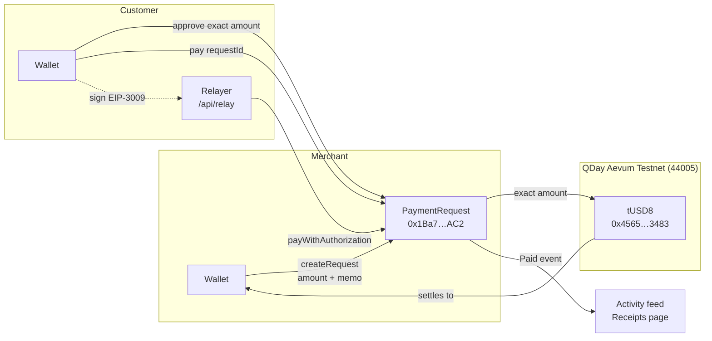

# Aevum Checkout — PaymentRequest

**Aevum Builder Challenge #1 entry (solo, @adimaspdam).** A simple stablecoin payment
checkout on QDay Aevum testnet: a merchant creates a payment request with a fixed amount
and a memo, a customer pays it in tUSD8, and the smart contract settles the exact amount
straight to the merchant. No amount parameter on `pay` — the amount lives on-chain in the
request, so a paid request is always fully paid.

> Based on Aevum Starter Kit (MIT, PQA Labs) — https://github.com/qday-io/aevum-starter-kit

> **Judging counts activity on Aevum.** Contracts, payments and transfers happen on Aevum
> testnet (chain `44005`). Nothing here settles on another chain.

---

## Contents

- [Live deployment](#live-deployment)
- [The problem](#the-problem)
- [How it works](#how-it-works)
- [Architecture](#architecture)
- [Contract API](#contract-api)
- [Why it is not the template](#why-it-is-not-the-template)
- [Project layout](#project-layout)
- [Quickstart](#quickstart)
- [Environment variables](#environment-variables)
- [Demo](#demo)
- [Submitting](#submitting)
- [License and credit](#license-and-credit)

---

## Live deployment

Network: **QDay Aevum Testnet, chain ID `44005`**. Deployed 2026-11-16.

| Item | Value |
|---|---|
| Contract | `PaymentRequest` |
| Address | [`0x1Ba709467e9770ECe772b5296CC141F6c4795AC2`](https://explorer-test.qday.info/address/0x1Ba709467e9770ECe772b5296CC141F6c4795AC2) |
| Deploy tx | [`0x8830cf59775f81392075e25aaf3fb481728353065f09d899df2dae833a6a44fc`](https://explorer-test.qday.info/tx/0x8830cf59775f81392075e25aaf3fb481728353065f09d899df2dae833a6a44fc) |
| Deploy block | `3,317,813` |
| Token (tUSD8) | [`0x456569838f1d43009A91ebA4263147Afd7233483`](https://explorer-test.qday.info/address/0x456569838f1d43009A91ebA4263147Afd7233483) (6 decimals) |
| Deployer | `0x8CAa665Be7C366B118D2229120636eEBc2C5766F` (test-only wallet) |
| RPC | `https://rpc-test.qday.info` (HTTPS only, no WebSocket) |
| Explorer | `https://explorer-test.qday.info` |
| EVM version | Shanghai |
| Gas token | tQDAY (18 decimals), ~1 gwei |

Source: this repo, template commit `b3ee8af` + the PaymentRequest work on top.
(Contract verification on the explorer is not working yet — see [Submitting](#submitting).
The exact commit is linked in the submission instead.)

### Proof it works (testnet transactions)

Smoke test from the phase-3 deploy (request `0x7dca…3956`, 0.1 tUSD8):

| Step | Tx |
|---|---|
| `createRequest` | [`0xe6a1bd9b…b7be`](https://explorer-test.qday.info/tx/0xe6a1bd9b6055ae42df202a4a22676dd887a22ec6cd55950b7f36c9785c10b7be) |
| `approve` | [`0xe38dcd39…f45199f`](https://explorer-test.qday.info/tx/0xe38dcd39cc8842ba27da16b8e3cff0b0e1d831f5d1530b13414c061acf45199f) |
| `pay` | [`0x873e47c2…b20a`](https://explorer-test.qday.info/tx/0x873e47c2877effbf457b7148330ed67fb4bd197ad817dc3daa1bfaf17064b20a) |

Web smoke test from the phase-4 production build (0.05 tUSD8 each, deployer self-payments):

| Step | Tx |
|---|---|
| `createRequest` (standard) | [`0x232dce66…431cb`](https://explorer-test.qday.info/tx/0x232dce66ca05cc68a8b27ae5211a88196facf239b9f72cda713aea914ec431cb) |
| `approve` | [`0x368a3d58…71fa7`](https://explorer-test.qday.info/tx/0x368a3d589bde853082d9524e38207178628972672c16835f784050d1dbf71fa7) |
| `pay` (standard) | [`0x60277993…0714f`](https://explorer-test.qday.info/tx/0x60277993072206deeec359e51fc314a4856c82394a9d0b95365be73c6b80714f) |
| `createRequest` (gasless) | [`0xb54525ad…ce7e`](https://explorer-test.qday.info/tx/0xb54525ad20b6d695bcda54812d35948840a0bff76a21519cd69fc2e7ce4dce7e) |
| `payWithAuthorization` (via `/api/relay`) | [`0x56ea4aed…b9896`](https://explorer-test.qday.info/tx/0x56ea4aed370a78ab1a900edfb5da86df450801dc2bc208f47a2321a8fe3b9896) |

Request ids: standard `0xbec364be910d9b1e456feb4f35abe79b7894b222509093939229569a3dc31b6a`,
gasless `0xdb311032f56557ef5db0bf5ea81c123037a44bac12b842ad698714077e368f52`.
Full deployment record: [`DEPLOYMENT.md`](DEPLOYMENT.md).

---

## The problem

A small merchant who wants to take stablecoin payments has two bad options: trust a
central payment link (the money passes through someone else's server), or wire up a
smart contract that was never built for the job. The starter kit's example contract
shows the trap clearly — it never decides a price, so `pay(orderId, 1)` marks an order
as paid for 0.000001 tUSD8 and can front-run the real buyer.

Aevum Checkout is the smallest thing that fixes that: a payment request is an invoice
stored on-chain. The merchant sets the amount once, the customer pays exactly that
amount, and the contract settles it straight to the merchant. A receipt is an on-chain
event, not a screenshot.

---

## How it works

### Merchant — create a request

1. Connect a wallet on the **Checkout** page, Merchant tab.
2. Enter an amount (tUSD8) and a memo — e.g. `Invoice #42 — logo design`.
3. `createRequest` stores the request on-chain. The request id is random
   (`keccak256(merchant, random)`), so only someone with your link can pay it.
4. Share the payment link (`/checkout?request=0x…`) with the customer.

### Customer — pay a request

1. Open the merchant's link. The app reads the amount from the contract — never from
   the link, never typed by the buyer.
2. Pay **Standard** (`approve` the exact amount, then `pay`) or **Gasless** (sign one
   EIP-3009 authorization; the relayer submits it and pays the gas — the buyer needs
   no tQDAY).
3. The `Paid` event is the receipt: the **Receipts** page reads it from the chain, and
   **Activity** lists every payment.

### Gasless path in detail

The buyer signs a `ReceiveWithAuthorization` message (EIP-712, tUSD8 domain) with the
value equal to the stored amount and the nonce equal to
`PaymentRequest.authorizationNonce(requestId)`. The relayer (`web/src/app/api/relay/route.ts`)
reads the request from the contract, simulates `payWithAuthorization`, then submits it.
The signature is bound to one request, valid for at most 1 hour, and only the contract
can pull the funds (`receiveWithAuthorization`, not `transferWithAuthorization`).

---

## Architecture



Components:

| Part | What it is |
|---|---|
| `contracts/src/PaymentRequest.sol` | The contract: requests, both payment paths, events. |
| `web/` | Next.js app (wagmi + RainbowKit): setup checker, merchant/customer checkout, receipts, activity feed, gasless relayer. |
| `packages/aevum/` | Shared chain config, ABIs, EIP-3009 typed data, chunked log reader. |
| `examples/` | TypeScript scripts (check setup, pay gasless, read payments) — kit reference, still targeting the kit's `Checkout` example. |

---

## Contract API

`contracts/src/PaymentRequest.sol` (Solidity ^0.8.24, EVM Shanghai).

```solidity
struct Request {
    address merchant; uint256 amount; string memo;
    uint64 createdAt; bool paid; address payer; uint64 paidAt;
}

function createRequest(bytes32 requestId, uint256 amount, string memory memo) external;
function pay(bytes32 requestId) external;
function payWithAuthorization(bytes32 requestId, address from,
    uint256 validAfter, uint256 validBefore, uint8 v, bytes32 r, bytes32 s) external;
function authorizationNonce(bytes32 requestId) public view returns (bytes32);
function requestOf(bytes32 requestId) external view returns (Request memory);
function isPaid(bytes32 requestId) external view returns (bool);

event RequestCreated(bytes32 indexed requestId, address indexed merchant, uint256 amount, string memo);
event Paid(bytes32 indexed requestId, address indexed payer, uint256 amount);

error AlreadyPaid(bytes32 requestId);
error UnknownRequest(bytes32 requestId);
error RequestExists(bytes32 requestId);
error ZeroAmount();
error ZeroAddress();
```

Rules the tests pin down (`contracts/test/PaymentRequest.t.sol`, 17 tests incl. fuzz;
`contracts/test/fork/PaymentRequestFork.t.sol`, 2 tests against the real tUSD8):

- `pay` always moves exactly the stored amount to the request's merchant. There is no
  amount parameter, so a dust payment can't mark a request paid.
- A request can be paid once. A second payment reverts (`AlreadyPaid`).
- Unknown ids revert (`UnknownRequest`). Creating the same id twice reverts
  (`RequestExists`). Zero amounts revert (`ZeroAmount`).
- Gasless: the signed nonce must be `authorizationNonce(requestId)` and the signed value
  must equal the stored amount. Wrong amount, expired window, or replayed signature all
  revert.
- Tokens never sit in the contract: both paths forward the amount to the merchant in the
  same call.

---

## Why it is not the template

The starter kit is an example; this project replaces its core and keeps its plumbing:

| Starter kit example | Aevum Checkout |
|---|---|
| `Checkout.sol`: one fixed merchant, price decided by the app | `PaymentRequest.sol`: merchant per request, amount stored on-chain |
| `pay(orderId, amount)` — any amount marks an order paid | `pay(requestId)` — no amount parameter, always the exact stored amount |
| `priceOf()` hardcoded demo price in the web app | `web/src/lib/requests.ts` reads the amount from `requestOf` |
| One demo order, one checkout page | Merchant tab (create + share link) and Customer tab (load + pay), deep-linkable via `?request=` |
| Relayer trusts the client's amount | Relayer reads the amount from the contract; the client sends no amount |
| Receipt checks `paymentOf` **and** its amount | Receipt trusts the contract's `paid` flag — a paid request is always fully paid |

Reused as-is from the kit: `packages/aevum` (chain config, ABIs, EIP-3009 helpers,
chunked log reader), the setup checker, receipts and activity pages, the relayer's rails,
`MockUSD8` + the fork workflow for free local testing, and the Shanghai build gate.

---

## Project layout

```
contracts/            Foundry project
  src/PaymentRequest.sol   the contract (this project)
  src/Checkout.sol         the kit's example, kept as reference
  src/mocks/MockUSD8.sol   local tUSD8 stand-in (anyone can mint)
  test/PaymentRequest.t.sol
  test/fork/PaymentRequestFork.t.sol
  script/Deploy.s.sol      deploys PaymentRequest
packages/aevum/       @aevum-kit/aevum — chain config, ABIs, EIP-3009, getLogsChunked
web/                  Next.js app (wagmi + RainbowKit)
  src/app/checkout/   Merchant + Customer tabs
  src/app/receipts/[requestId]/   on-chain receipts
  src/app/activity/   Paid event feed (1,000-block chunks from deploy block)
  src/app/api/relay/  gasless relayer (with rails)
  src/lib/requests.ts requests: ids, on-chain reads, share links
examples/             TS scripts (kit reference)
tools/check-shanghai.mjs  fails the build on Cancun-only opcodes
DEPLOYMENT.md         deployment + smoke-test record (testnet tx hashes)
```

---

## Quickstart

You need [Node 22+](https://nodejs.org), [pnpm](https://pnpm.io/installation) and
[Foundry](https://book.getfoundry.sh/getting-started/installation) (`foundryup`).

```bash
git clone --recursive https://github.com/DimasFrR/aevum-checkout.git
cd aevum-checkout
make install          # Solidity libs + JS packages
make check            # build, Shanghai opcode check, unit tests, fork tests
```

### Run against a local copy of Aevum (no funds needed)

```bash
# terminal 1: local copy of Aevum testnet on 127.0.0.1:8555 (chain 440050)
make fork

# terminal 2: deploy PaymentRequest and give yourself test money
make deploy-fork                      # prints the PaymentRequest address
make deal TO=<your wallet address>    # 100 tUSD8 + 10 tQDAY, on the fork only

cp web/.env.example web/.env.local
#   NEXT_PUBLIC_NETWORKS=fork,aevum
#   NEXT_PUBLIC_CHECKOUT_FORK=<address from deploy-fork>
#   RELAYER_PRIVATE_KEY=<an anvil test key>   (optional: enables gasless mode)
make dev                              # http://localhost:3000
```

Use the **Local fork / Aevum testnet** switcher in the header. The first time you pick
the fork, your wallet offers to add "Aevum fork (local)" as a new network.

### Run against the real testnet

```bash
make deploy-aevum ACCOUNT=aevum-deployer   # needs a keystore: cast wallet import <name> --interactive
# then in web/.env.local:
#   NEXT_PUBLIC_NETWORKS=aevum
#   NEXT_PUBLIC_CHECKOUT_AEVUM=<address from deploy-aevum>
#   NEXT_PUBLIC_DEPLOY_BLOCK_AEVUM=<deploy block>
#   RELAYER_PRIVATE_KEY=<a fresh test wallet with a little tQDAY>  (optional: gasless)
make dev
```

Get test tokens from the QDay Discord: join, react ✅ in `#verify`, then
`/faucet <your address>` in `#faucet` (1 tQDAY + 5 tUSD8, once per Discord account
and once per address). The web faucet only pays addresses holding a little ETH/USDT/USDC
on Ethereum mainnet — use the Discord faucet for a fresh test wallet.

---

## Environment variables

Copy `web/.env.example` to `web/.env.local` (never commit it).

| Variable | What it is |
|---|---|
| `NEXT_PUBLIC_NETWORKS` | Networks the app offers, comma-separated. First is the default. Production: `aevum` only. |
| `NEXT_PUBLIC_CHECKOUT_AEVUM` | PaymentRequest address on Aevum testnet. Live: `0x1Ba709467e9770ECe772b5296CC141F6c4795AC2`. |
| `NEXT_PUBLIC_CHECKOUT_FORK` / `_LOCAL` | PaymentRequest address on the local fork / anvil. |
| `NEXT_PUBLIC_DEPLOY_BLOCK_AEVUM` | First block the Activity page scans from. Live: `3317813`. |
| `NEXT_PUBLIC_REPO_URL` | Where the Docs "Source" link points. Placeholder until the repo exists: `https://github.com/DimasFrR/aevum-checkout`. |
| `NEXT_PUBLIC_WC_PROJECT_ID` | Optional. WalletConnect project id (free at cloud.reown.com). Without it, browser-extension wallets still work. |
| `RELAYER_PRIVATE_KEY` | Server only. Enables gasless mode. A fresh test wallet with a little tQDAY — never one holding anything of value. Anvil's public keys are refused on Aevum testnet. |
| `RELAYER_DAILY_TX_LIMIT` | Optional. Max relayer transactions per day per server process (default 500). |
| `TRUSTED_IP_HEADER` | Optional. The header your host sets with the real client IP (Vercel: `x-vercel-forwarded-for`). Unset: last `X-Forwarded-For` entry. |

---

## Demo

- **Live app:** _to be deployed on Vercel_ (needs the builder's Vercel account; `NEXT_PUBLIC_NETWORKS=aevum` only, relayer key as a Sensitive env var).
- **Demo video:** _to be recorded_ — screen capture, 2–3 min, no face: (1) merchant creates a
  request, (2) customer opens the link and pays gasless, (3) receipt page + explorer tx,
  (4) activity feed shows the `Paid` event.
- **Try it now without the app:** the transactions in [Live deployment](#live-deployment)
  are on the explorer, and `examples/` shows the same flows as scripts.

---

## Submitting

Challenge: **Aevum Builder Challenge #1** — submit at
[https://dorahacks.io/hackathon/qday/detail](https://dorahacks.io/hackathon/qday/detail)
before **11 Dec 2026, 16:00 HKT (15:00 WIB)**. Late submissions aren't accepted.
Judging 12–14 Dec 2026; Demo Day + winners 15 Dec 2026, 14:00 HKT. Prizes $1,500 USDT
(1st $800, 2nd $500, 3rd $200). Track: **Invoice Payments**.

Pre-submit checklist:

- [x] Contracts + web app on Aevum testnet (44005), with explorer links and tx hashes.
- [x] `make check` green: 33/33 tests (28 local + 5 fork), build + Shanghai check.
- [x] README a stranger can run the project from.
- [x] No private keys, `.env` files or API keys in the repo or its history.
- [x] Open-source license (MIT) + template credit (below).
- [ ] Public GitHub repo (to be created as `DimasFrR/aevum-checkout`; local work is in
      `~/workspace/aevum-checkout/`).
- [ ] Live demo deployed (Vercel — needs the builder's account).
- [ ] Demo video recorded.
- [ ] Submitted on DoraHacks before the deadline (submit early — the portal gets slow).

Known limitation: contract verification on the explorer isn't working yet
(`forge verify-contract` submits but returns "Fail - Unable to verify", as the kit
documents). Mitigation: the exact addresses, deploy tx, deploy block and source commit
are in this README and in [`DEPLOYMENT.md`](DEPLOYMENT.md); retry verification if the
explorer is fixed.

---

## License and credit

MIT licensed. This project is based on the **Aevum Starter Kit (MIT, © 2026 PQA Labs)** —
see [`LICENSE`](LICENSE) and [`NOTICE.md`](NOTICE.md). The kit's `Checkout.sol` example
and its tests are kept in this repo as reference; `PaymentRequest.sol`, its tests, and
the merchant/customer web app are this project's own work.

Third-party dependencies and their licenses are listed in [`NOTICE.md`](NOTICE.md).
